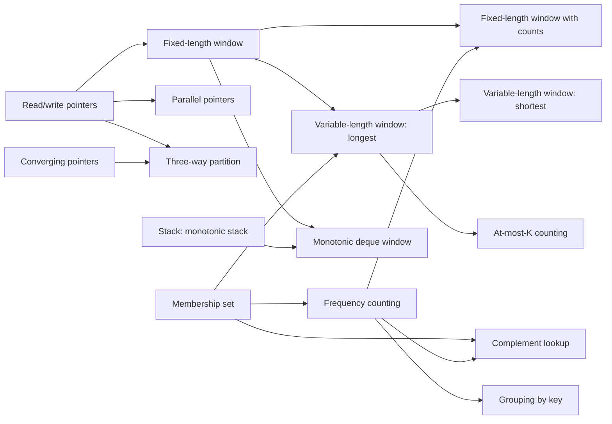

# The Patterns category: taxonomy and naming

Status: **Arrays & Hashing is built** (categories/patterns/bricks/arrays_hashing.py); the rest is the plan. This
document fixes the vocabulary, the names, and the order before any problem is written, because renaming a variant after problems, tests and saved progress refer to it is
expensive, and because the names are part of what the learner takes away.

## 1. The model

| Level | What it is | Example |
| --- | --- | --- |
| **Category** | A kind of interview round. It decides the page and editor. | SQL · Implementation · **Patterns** |
| **Pattern** | A named technique family: what the interview guides call "a pattern". | Sliding Window |
| **Variant** | The smallest teachable idea: one invariant, one template. A "brick" on the wall. | Fixed-length window |
| **Problem** | Belongs to exactly one variant, and has one **role** in that variant's sequence. | a twin of the worked example |

Roles, in the order a learner meets them:

| Role | What the learner does | Why |
| --- | --- | --- |
| **example** | Steps through a solved problem, predicting each next state before it's shown | Worked-example effect, with prediction as active retrieval |
| **completion** | Fills in the blanked key lines of a near-copy | Fading: the bridge from reading to writing |
| **twin** | Solves the same structure in a different story, from scratch | Transfer with nothing else changed |
| **variation** | Solves a problem that differs in exactly one declared dimension | Variation theory: holding the rest fixed reveals which part mattered |
| **stretch** | A bigger twist, or a combination with an earlier variant | Consolidation |
| **review** | A held-back twin that returns on a spaced schedule (1, 3, 7, 21 days) | Spacing; never the same problem twice |
| **drill** | Reads a statement and names the variant, then the signal that gave it away; no code | Recognition, the skill interviews actually test |

A variant counts as **laid** when its variation or its stretch is solved without revealing that problem's solution
first. Anyone can **test out** of a variant by solving its variation cold (worked examples slow down people who already
know the idea); the stretch is a second way in for someone who revealed the variation's solution.
The path is **recommended, not locked**: prerequisites decide the suggested order and what the review queue offers, but
every variant can be opened at any time.

Every variant records the same fields: key, canonical name, name status, aliases, sources, idea, invariant, template,
complexity, signals, near-misses (what it's confused with), common mistakes, prerequisites, and its problems. Common
mistakes are not just prose: each one becomes at least one test whose name says what it catches ("the window has to
shrink twice here: is the shrink a `while`?").

## 2. The naming rule

Applied in order, with the reason recorded for every name:

1. **Consensus.** If the major interview guides (NeetCode, Grokking the Coding Interview, Hello Interview, Tech
   Interview Handbook) agree, use their name.
2. **Textbook.** If they disagree, use the textbook or competitive-programming name (Laaksonen's *Competitive
   Programmer's Handbook*, CLRS, cp-algorithms).
3. **Ours.** If there is no established name, use a plain descriptive one in the same style, marked *ours*, with the
   names others use as aliases so a search for any of them finds it.

Name status is shown on each entry: **consensus**, **textbook**, or **ours**.

## 3. Patterns, in the recommended order

The order follows NeetCode's roadmap where it is explicit (Arrays & Hashing, Two Pointers, Sliding Window, Stack,
Binary Search, Linked List, Trees, ...). It adds Prefix Sums, which NeetCode folds into other topics but many guides
and the textbooks treat on its own, and splits out the patterns Grokking treats separately (Fast & Slow Pointers,
Top-K, Two Heaps, K-way Merge). Only the first three are specified here; each later pattern
gets the same treatment, and a review of its names, when we reach it.

1. **Arrays & Hashing** (specified below)
2. **Two Pointers** (specified below)
3. **Sliding Window** (specified below)
4. Prefix Sums
5. Stack (including Monotonic Stack)
6. Binary Search (including searching on the answer)
7. Linked Lists
8. Fast & Slow Pointers
9. Trees
10. Tries
11. Heaps (Top-K, Two Heaps, K-way Merge)
12. Intervals
13. Graphs
14. Backtracking
15. Dynamic Programming
16. Greedy
17. Bit Manipulation

## 4. Prerequisites for the first three patterns



Monotonic deque window needs the Stack pattern's monotonic stack, so on the recommended path it comes after Stack,
even though it belongs to Sliding Window.

---

## Pattern 1: Arrays & Hashing

- **Key** `arrays-hashing` · **Name status** consensus (NeetCode's first topic) · **Aliases** hashing, hash map
  patterns, hash set patterns
- **The idea** Trade memory for time: remember what you have seen, so each question about it is one O(1) lookup instead
  of a rescan.
- **Prerequisites** Python's `dict` and `set`; nothing else.

No guide we found names the variants inside this pattern, so all four names are **ours**.

### 1.1 Membership set

- **Key** `membership-set` · **Name status** ours · **Aliases** seen set, visited set, hash set lookup
- **Idea** Keep a set of everything seen so far; ask the set before adding to it.
- **Invariant** Before step `i`, `seen` holds exactly the elements before index `i`.
- **Template**
  ```python
  seen = set()
  for x in items:
      if x in seen:
          ...            # x appeared before
      seen.add(x)
  ```
- **Complexity** O(n) time, O(n) space
- **Signals** "any duplicates", "has this appeared before", "first repeated", "is every item unique"
- **Near-misses** frequency counting (when you need *how many*, not *whether*)
- **Common mistakes** adding before checking (every item finds itself); a list instead of a set (O(n²)); unhashable
  items (a list can't go in a set; use a tuple)
- **Problems (draft)**

  | Role | Problem | What changes |
  | --- | --- | --- |
  | example | Any badge scanned twice at the door? | |
  | completion | The first badge scanned twice (the check-before-add line is blank) | |
  | twin | Did any username sign up twice? | story only |
  | variation | Which username repeats first, as opposed to whether any does | boolean → the element |
  | stretch | The longest run of consecutive ticket numbers, in O(n) (only start counting at run starts) | combines with a second idea |

### 1.2 Frequency counting

- **Key** `frequency-counting` · **Name status** ours · **Aliases** frequency map, counter, histogram, tally
- **Idea** Map each value to how many times it has appeared.
- **Invariant** `count[x]` is the number of times `x` occurs in the part processed so far.
- **Template**
  ```python
  count = {}
  for x in items:
      count[x] = count.get(x, 0) + 1
  ```
- **Complexity** O(n) time, O(k) space for k distinct values
- **Signals** "how many times", "most common", "same letters", "rearrangement of", "majority"
- **Near-misses** membership set (only whether); sorting (works, but O(n log n) where counting is O(n))
- **Common mistakes** `KeyError` on a missing key; comparing two dicts after decrementing, when zero entries are left
  behind and break the equality; sorting when counting suffices
- **Problems (draft)**

  | Role | Problem | What changes |
  | --- | --- | --- |
  | example | Are two words rearrangements of each other? | |
  | completion | Can a note be cut out of a magazine's letters? (the decrement and the below-zero check are blank) | |
  | twin | Can these letter tiles spell this word? | story only |
  | variation | The first character that appears exactly once | compare two tallies → query one tally |
  | stretch | The k most frequent tags, by bucketing on count (bucket sort by frequency) | combines with bucketing |

### 1.3 Complement lookup

- **Key** `complement-lookup` · **Name status** ours · **Aliases** two-sum hash map, target-minus-x, index map
- **Idea** For each `x`, the partner it needs is determined (`target - x`); look it up among the earlier elements, then
  store `x`.
- **Invariant** Before step `i`, the map holds value → index for exactly the elements before `i`.
- **Template**
  ```python
  index = {}
  for i, x in enumerate(nums):
      if target - x in index:
          return index[target - x], i
      index[x] = i
  ```
- **Complexity** O(n) time, O(n) space
- **Signals** "two items that add up to", "pair with difference", unsorted input, the answer is positions
- **Near-misses** converging pointers (if the input is sorted, or may be sorted, and O(1) space matters); later,
  prefix sums with a hash map (the same idea over running sums)
- **Common mistakes** storing before checking (pairs an element with itself); returning values when positions were asked
  for; a nested loop (O(n²))
- **Problems (draft)**

  | Role | Problem | What changes |
  | --- | --- | --- |
  | example | Two gift cards that exactly cover a purchase: which two? | |
  | completion | A pair of readings whose difference is exactly d (both lookups, x + d and x − d, are blank) | |
  | twin | Two shipments whose weights sum to a truck's limit | story only |
  | variation | How many pairs sum to the target (store counts instead of positions) | find one → count all |
  | stretch | Pairs of song lengths whose total is a multiple of 60 (complement by remainder) | combines with modular arithmetic |

### 1.4 Grouping by key

- **Key** `grouping-by-key` · **Name status** ours · **Aliases** canonical key, bucketing, group by signature
- **Idea** Compute a canonical key for each item, so items that are "the same" in the sense you care about share a key;
  collect items by key.
- **Invariant** `groups[key(x)]` holds every processed item with that key.
- **Template**
  ```python
  groups = {}
  for x in items:
      groups.setdefault(key(x), []).append(x)
  ```
- **Complexity** O(n · cost of key)
- **Signals** "group", "which are equivalent", "classify", "the same up to order / shift / case"
- **Near-misses** frequency counting (counting per key instead of collecting)
- **Common mistakes** an unhashable key (`list` instead of `tuple`); a key that isn't canonical (unsorted letters);
  returning the dict when a list of groups was asked for
- **Problems (draft)**

  | Role | Problem | What changes |
  | --- | --- | --- |
  | example | Group words that are rearrangements of each other (key: sorted letters) | |
  | completion | The same, with a letter-count key (the 26-count tuple is blank) | |
  | twin | Group product codes that use the same characters | story only |
  | variation | Group strings that are shifts of each other (key: gaps between letters) | which key |
  | stretch | Find duplicate files by content (content → paths; keep groups of two or more) | combines with filtering groups |

---

## Pattern 2: Two Pointers

- **Key** `two-pointers` · **Name status** consensus · **Aliases** two-pointer technique, two pointers method
  (Laaksonen §8.1)
- **The idea** Two indices move through the data under a rule that guarantees no needed pair is skipped, so one pass
  replaces checking every pair: O(n) instead of O(n²), usually with O(1) extra space.
- **Prerequisites** none strictly; Arrays & Hashing first is recommended (complement lookup is the contrast for
  converging pointers).

The guides consistently split two pointers by direction (opposite vs same). We keep that split and name the variants
by what the pointers do.

### 2.1 Converging pointers

- **Key** `converging-pointers` · **Name status** consensus · **Aliases** opposite-direction pointers, opposite ends,
  left/right pointers
- **Idea** Start at both ends of sorted data and move inward; each move rules out every pair involving the pointer you
  move.
- **Invariant** If an answer exists, it uses indices inside `[left, right]`.
- **Template**
  ```python
  left, right = 0, len(a) - 1
  while left < right:
      s = a[left] + a[right]
      if s == target:
          return left, right
      if s < target:
          left += 1      # a[left] is too small to pair with anything left
      else:
          right -= 1     # a[right] is too big to pair with anything left
  ```
- **Complexity** O(n) after sorting, O(1) space
- **Signals** sorted input (or input you may sort), pairs, symmetry, "from both ends", palindromes
- **Near-misses** complement lookup (unsorted, original positions needed)
- **Common mistakes** moving the wrong pointer; `<=` instead of `<` (an element paired with itself); assuming sorted
  input that isn't; in three-sum, not skipping duplicates
- **Problems (draft)**

  | Role | Problem | What changes |
  | --- | --- | --- |
  | example | Two prices in a sorted list that hit a budget exactly | |
  | completion | Is a sentence a palindrome, ignoring punctuation and case? (the skip logic is blank) | |
  | twin | Two sorted ticket prices that use a voucher exactly | story only |
  | variation | The pair whose sum is closest to the budget | exact match → track the best |
  | stretch | All distinct triples summing to zero (fix one, converge on the rest, skip duplicates) | combines with an outer loop |

### 2.2 Read/write pointers

- **Key** `read-write-pointers` · **Name status** ours · **Aliases** same-direction pointers, slow and fast index,
  in-place compaction
- **Idea** `read` scans every element; `write` marks where the next kept element goes.
- **Invariant** `a[:write]` is the finished output; nothing at or after `write` matters yet.
- **Template**
  ```python
  write = 0
  for read in range(len(a)):
      if keep(a[read]):
          a[write] = a[read]
          write += 1
  return write
  ```
- **Complexity** O(n) time, O(1) space
- **Signals** "in place", "O(1) extra space", "remove", "compact", "move to the end", "return the new length"
- **Near-misses** building a new list (correct, but not in place); converging pointers (both ends)
- **Common mistakes** building a new list when in place was required; returning the wrong length; comparing to the
  wrong neighbour in the duplicates variation (`a[read - 1]` instead of `a[write - 1]`)
- **Problems (draft)**

  | Role | Problem | What changes |
  | --- | --- | --- |
  | example | Remove every occurrence of a value from a list, in place | |
  | completion | Move the zeros to the end, keeping the order of the rest (the write step is blank) | |
  | twin | Strip blank lines from a log, in place | story only |
  | variation | Remove duplicates from a sorted list (keep if different from the last *written*) | the keep rule depends on the output |
  | stretch | Keep at most two of each value (compare with `a[write - 2]`) | generalizes the keep rule |

### 2.3 Parallel pointers

- **Key** `parallel-pointers` · **Name status** ours (some guides say "parallel traversal"; the major ones don't name
  it) · **Aliases** parallel traversal, merge-style pointers
- **Idea** One pointer per sequence; at each step advance the one whose element comes first.
- **Invariant** Everything before `i` in `A` and before `j` in `B` has been handled, in order.
- **Complexity** O(n + m)
- **Signals** two sorted sequences, "merge", "is a subsequence of", "common to both"
- **Near-misses** converging pointers (one sequence, both ends); a set intersection (loses order and counts)
- **Common mistakes** forgetting the leftover tail of one sequence; advancing both pointers on a mismatch
- **Problems (draft)**

  | Role | Problem | What changes |
  | --- | --- | --- |
  | example | Merge two sorted lists of timestamps | |
  | completion | Is one word a subsequence of another? (the advance rule is blank) | |
  | twin | IDs present in both of two sorted lists | story only |
  | variation | The same, keeping duplicates as many times as both lists have them | sets → multisets |
  | stretch | Merge into the first array in place, filling from the back | combines with read/write pointers |

### 2.4 Three-way partition

- **Key** `three-way-partition` · **Name status** textbook (Dijkstra's Dutch national flag problem) · **Aliases** Dutch
  national flag, 3-way partitioning
- **Idea** Three pointers split the array into "less", "equal", "unknown" and "greater" regions in one pass.
- **Invariant** `a[:low]` < pivot, `a[low:mid]` == pivot, `a[mid:high + 1]` unknown, `a[high + 1:]` > pivot.
- **Complexity** O(n) time, O(1) space
- **Signals** sort with three distinct keys; partition around a value into less / equal / greater
- **Near-misses** a counting pass (works for three fixed values, but not for a general pivot); a two-way partition
- **Common mistakes** advancing `mid` after swapping with `high` (the swapped-in element is still unknown)
- **Problems (draft)**

  | Role | Problem | What changes |
  | --- | --- | --- |
  | example | Sort tickets labelled low / medium / high priority, in one pass | |
  | completion | Partition numbers around a pivot into less / equal / greater (the `high` branch is blank) | |
  | twin | Arrange red, white and blue tiles | story only |
  | variation | Two-way: evens before odds | three regions → two |
  | stretch | Partition around a pivot and return where the "equal" block starts and ends | the output changes |

### Placed elsewhere

- **Diverging pointers** (expand around a center, for palindromic substrings): later, as a stretch, once string
  problems need it.
- **Fast & slow pointers** (Floyd's tortoise and hare): its own pattern after Linked Lists, as in Grokking, because its
  main uses are linked lists.

---

## Pattern 3: Sliding Window

- **Key** `sliding-window` · **Name status** consensus · **Aliases** windowing, caterpillar method
- **The idea** Keep a contiguous range `[left, right]` and its summary, and update the summary as the range moves,
  instead of recomputing it for every range.
- **Prerequisites** read/write pointers (same-direction movement), membership set and frequency counting (window state).

The guides disagree on whether sliding window is a kind of two pointers (same direction, with the range between them)
or a pattern of its own. We follow NeetCode and Grokking and make it its own pattern; the first lesson says plainly that
it is same-direction two pointers that maintain what lies between them.

The guides' "variable-length window" is split here into *longest* and *shortest*. The split is deliberate: the two
record the answer in different places (after the shrink loop vs inside it), which is exactly what breaks a memorized
template.

### 3.1 Fixed-length window

- **Key** `fixed-length-window` · **Name status** consensus · **Aliases** fixed-size window
- **Idea** Slide a window of exactly `k` items: add the item entering on the right, remove the one leaving on the left.
- **Invariant** After step `i` (once `i >= k - 1`), the state describes exactly `a[i - k + 1 .. i]`.
- **Template**
  ```python
  total = best = sum(a[:k])
  for i in range(k, len(a)):
      total += a[i] - a[i - k]
      best = max(best, total)
  ```
- **Complexity** O(n) instead of O(n·k)
- **Signals** "k consecutive", "every window of size k", "subarray of length k"
- **Near-misses** prefix sums (also O(n) for fixed-length sums, and for any range query)
- **Common mistakes** recomputing each window from scratch (a scale test times out); counting the first window before it
  is full; removing `a[i - k + 1]` instead of `a[i - k]`
- **Problems (draft)**

  | Role | Problem | What changes |
  | --- | --- | --- |
  | example | The best k consecutive days of sales | |
  | completion | The highest average over k consecutive readings (the removal is blank) | |
  | twin | The busiest k-minute stretch of requests | story only |
  | variation | How many k-day stretches average at least a threshold | best → count |
  | stretch | The most vowels in any k-letter stretch of text (state is a count, not a sum) | what the state is |

### 3.2 Fixed-length window with counts

- **Key** `fixed-length-window-counts` · **Name status** ours · **Aliases** fixed window with a frequency map,
  anagram window
- **Idea** A fixed-length window whose state is a frequency map, often with a counter of how many characters already
  match a target.
- **Invariant** `count` is the frequency map of exactly the window; `matched` is the number of distinct characters whose
  count equals the target's.
- **Complexity** O(n) (O(n · alphabet) if comparing whole maps each step)
- **Signals** "an anagram / rearrangement / permutation of p appears in s", "windows of size k with all distinct"
- **Near-misses** frequency counting over the whole input; variable-length windows (when the length isn't given)
- **Common mistakes** rebuilding the map for every window; leaving zero counts behind, so map comparisons fail; a window
  length other than `len(p)`
- **Problems (draft)**

  | Role | Problem | What changes |
  | --- | --- | --- |
  | example | Does a text contain a rearrangement of a word? | |
  | completion | Every position where a rearrangement starts (the left-side update is blank) | |
  | twin | Every place a DNA probe's rearrangement occurs in a strand | story only |
  | variation | How many k-letter windows have all distinct letters | match a target → a property of the window |
  | stretch | The most distinct letters in any k-letter window | count → maximize |

### 3.3 Variable-length window: longest

- **Key** `variable-window-longest` · **Name status** ours (a split of the consensus "variable-length window")
  · **Aliases** dynamic window, flexible window, maximize window, expand and shrink
- **Idea** Grow on the right; while the window is invalid, shrink from the left; then record its length.
- **Invariant** After the shrink loop, `[left, right]` is valid, and it is the longest valid window ending at `right`.
- **Template**
  ```python
  left = best = 0
  for right in range(len(a)):
      add(a[right])
      while not valid():
          remove(a[left])
          left += 1
      best = max(best, right - left + 1)
  ```
- **Complexity** O(n): each element enters and leaves the window once, even with the nested `while`
- **Signals** "longest / maximum length substring or subarray such that ..."; the condition is monotone (if a window is
  valid, so is every window inside it)
- **Near-misses** prefix sums with a hash map (when values can be negative, validity isn't monotone and the window
  fails); shortest windows (where the answer is recorded)
- **Common mistakes** `if` instead of `while` when shrinking; recording before shrinking; moving `left` backwards when
  jumping with an index map (use `max`)
- **Problems (draft)**

  | Role | Problem | What changes |
  | --- | --- | --- |
  | example | The longest stretch of text with no repeated character | |
  | completion | The longest run of purchases within a budget, all prices positive (the `while` condition is blank) | |
  | twin | The longest stretch of a playlist with no song repeated | story only |
  | variation | The longest stretch with at most k distinct characters | the validity rule |
  | stretch | The longest stretch you can make one letter by changing at most k others (valid when length − top count ≤ k) | a non-obvious validity rule |

### 3.4 Variable-length window: shortest

- **Key** `variable-window-shortest` · **Name status** ours (a split of the consensus "variable-length window")
  · **Aliases** minimize window, shrink while valid
- **Idea** Grow on the right until the window is valid; while it stays valid, record it and shrink from the left.
- **Invariant** After the shrink loop the window is just invalid; every valid window ending at `right` was recorded
  inside the loop.
- **Template**
  ```python
  left, best = 0, float("inf")
  for right in range(len(a)):
      add(a[right])
      while valid():
          best = min(best, right - left + 1)
          remove(a[left])
          left += 1
  return 0 if best == float("inf") else best
  ```
- **Complexity** O(n)
- **Signals** "shortest / minimum length subarray or substring such that ..."
- **Near-misses** longest windows (same loop, different place to record)
- **Common mistakes** recording after the loop (records a window that is no longer valid); forgetting the "none
  exists" answer; `if` instead of `while`
- **Problems (draft)**

  | Role | Problem | What changes |
  | --- | --- | --- |
  | example | The fewest consecutive days to reach a step goal | |
  | completion | The shortest stretch of orders reaching a revenue target (the record line's position is the blank) | |
  | twin | The shortest run of deposits reaching a savings goal | story only |
  | variation | The shortest stretch of text containing every required letter, with multiplicity | sum → coverage of a multiset |
  | stretch | The shortest stretch of shop visits that covers every product type | combines with counts |

### 3.5 At-most-K counting

- **Key** `at-most-k-counting` · **Name status** ours (no formal name exists; "the at most K trick" is the common label)
  · **Aliases** at most K trick, exactly K = at most K − at most K−1, complement rule, inclusion–exclusion
- **Idea** To count subarrays, run a longest-style window and add `right - left + 1` at each step: every window ending
  at `right` and starting in `[left, right]` is valid. "Exactly K" is "at most K" minus "at most K − 1".
- **Invariant** After the shrink loop, all `right - left + 1` windows ending at `right` are valid, and no longer one is.
- **Complexity** O(n) (twice, for "exactly")
- **Signals** "count the number of subarrays / substrings such that ...", "exactly K", "at most K"
- **Near-misses** prefix sums with a hash map (counting subarrays with an exact sum, values possibly negative)
- **Common mistakes** trying to count "exactly K" with one window; adding 1 per step instead of `right - left + 1`; the
  K = 0 case of "at most K − 1"
- **Problems (draft)**

  | Role | Problem | What changes |
  | --- | --- | --- |
  | example | How many stretches of a playlist have at most k distinct genres? | |
  | completion | How many runs of positive prices stay within a budget (the count line is blank) | |
  | twin | How many stretches of a log mention at most k distinct services | story only |
  | variation | How many stretches have exactly k distinct genres | at most → exactly |
  | stretch | How many stretches contain exactly k odd numbers | combines with a transformed condition |

### 3.6 Monotonic deque window

- **Key** `monotonic-deque-window` · **Name status** textbook (Laaksonen §8.3 "sliding window minimum") · **Aliases**
  sliding window maximum / minimum, monotonic queue, min-queue
- **Idea** Keep a deque of indices inside the window whose values are decreasing (for maximum); the front is the
  window's maximum.
- **Invariant** The deque holds only indices in the window, with values strictly decreasing from front to back.
- **Complexity** O(n): each index is pushed and popped at most once
- **Signals** "the maximum / minimum of every window of size k", windowed extremes in O(n)
- **Near-misses** a heap (O(n log k), with lazy deletion); recomputing each window (O(n·k))
- **Common mistakes** storing values instead of indices (can't tell when one leaves the window); `<` vs `<=` with equal
  values; evicting the front after reading it instead of before
- **Prerequisites** fixed-length window, and the Stack pattern's monotonic stack
- **Problems (draft)**

  | Role | Problem | What changes |
  | --- | --- | --- |
  | example | The hottest temperature in every k-day stretch | |
  | completion | The cheapest price in every k-day stretch: the same deque kept increasing (the comparison is blank) | |
  | twin | The peak load in every k-minute stretch | story only |
  | variation | The longest stretch where highest − lowest ≤ a limit (two deques, variable window) | fixed → variable |
  | stretch | (to be chosen with the Stack pattern) | |

### The boundary of the pattern

Not a variant, but a contrast lesson with its own drills: **when the window doesn't work.** With negative numbers, a
longer window can have a smaller sum, so validity isn't monotone and shrinking can skip the answer. The fix (prefix sums
with a hash map) belongs to Prefix Sums; the contrast is taught where both are known.

---

## 5. Recognition drills

Each drill is a problem statement with no code, and two quick questions, both auto-graded:

1. **Which variant?** Multiple choice. The wrong answers are near-misses taken from the variant's own *near-misses*
   field (for a "longest" problem: "shortest", "prefix sums", "fixed-length").
2. **What told you?** Pick the signal in the statement ("contiguous, all positive, longest").

Drills only include variants the learner has laid, plus at most one unfamiliar distractor. They are mixed across
patterns: the point is telling patterns apart, which practice inside one labelled section never trains.

## 6. Authoring checklist, per variant

- [ ] The entry above is complete and the names are reviewed
- [ ] Lesson: idea, invariant in bold, a step-through visual of the state
- [ ] Worked example with a trace to step through (predict, then reveal)
- [ ] Completion, twin, variation (with "what changes"), stretch
- [ ] Three or more review twins
- [ ] Three or more drills
- [ ] Every common mistake has at least one named test that catches it
- [ ] A scale test where the naive approach times out, if the variant is about speed
- [ ] `./butterbricks.py selftest` passes

## Sources

- NeetCode roadmap topic order: [NEETCODE-ROADMAP](https://github.com/aridepai17/NEETCODE-ROADMAP),
  [Educative on the NeetCode roadmap](https://www.educative.io/blog/neetcode-roadmap)
- Grokking the Coding Interview patterns: [dipjul/grokking-the-coding-interview-patterns-for-coding-questions](https://github.com/dipjul/grokking-the-coding-interview-patterns-for-coding-questions),
  [DesignGurus](https://www.designgurus.io/blog/grokking-the-coding-interview-patterns)
- Two pointers by direction: [Educative](https://www.educative.io/answers/how-many-ways-do-pointers-move-in-the-two-pointers-pattern),
  [mcfongtw](https://mcfongtw.github.io/CodingInterview/two-pointer.html)
- Fixed vs variable windows: [Hello Interview](https://www.hellointerview.com/learn/code/sliding-window/variable-length),
  [techinterview.org](https://www.techinterview.org/post/3233460634/sliding-window-interview-patterns/?format=md)
- The at most K trick: [fork-my-brain](https://fork-my-brain.pages.dev/🔱-DSA/Learn-By-Patterns/2.-Sliding-Window/1.-At-Most-Problems)
- Two pointers method, sliding window minimum: Antti Laaksonen, *Competitive Programmer's Handbook*, §8.1 and §8.3
  ([copy](https://www.academia.edu/37079888/Competitive_Programmers_Handbook))
